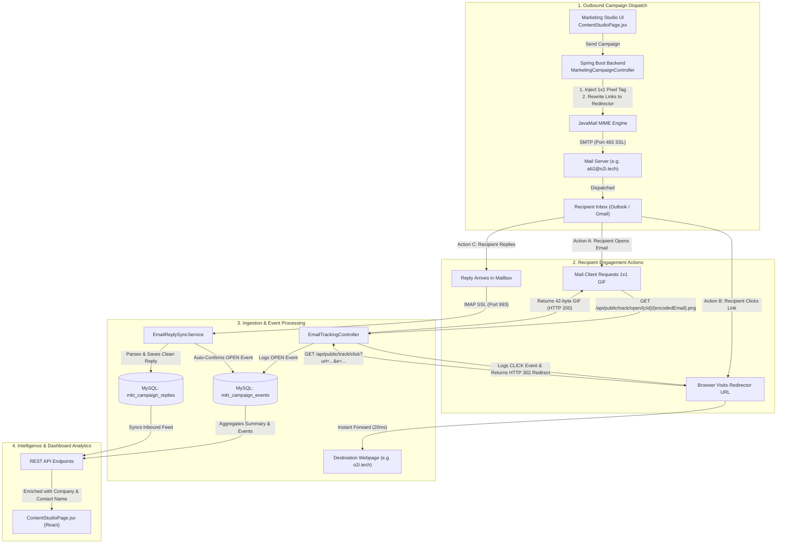

# 📬 Email Engagement Tracking & Inbound Reply Intelligence Guide
> **Enterprise-grade, 100% Free, Provider-Agnostic Tracking & IMAP Sync Architecture**

---

## 📌 Executive Summary

This document explains the architecture, operational workflow, and security of the **Email Engagement Tracking & Inbound Reply Intelligence System** integrated into the Agentic AI Platform.

The platform provides complete visibility into outbound campaigns:
1. **Email Opens** via an invisible 1x1 transparent tracking pixel.
2. **Link Clicks** via an instant HTTP 302 redirect engine.
3. **Inbound Replies** synchronized directly from IMAP mailboxes (GoDaddy, Google Workspace, Microsoft 365, Zoho, etc.).
4. **Smart Thread Parsing** separating the recipient's new response from older quoted pitches.
5. **Entity Enrichment** displaying the recipient's Company and Contact Name across all activity logs.

---

## 🏗️ End-to-End Architectural Flow



---

## ⚙️ Core Technical Components

### 1. Email Open Tracking (1x1 Transparent Pixel)
- **Injection (`MarketingCampaignController.java`)**:
  Before dispatch, an invisible `` tag is injected before `</body>`:
  ```html
  
  ```
  The recipient's email is encoded with URL-safe Base64.
- **Handling (`EmailTrackingController.java`)**:
  When the recipient opens the email, their email client fetches the image:
  1. Decodes Base64 to retrieve the plain email address.
  2. Captures Client IP address (`X-Forwarded-For` or remote socket) and `User-Agent`.
  3. Records an `OPEN` event into `mkt_campaign_events`.
  4. Returns strict cache-busting headers (`Cache-Control: no-cache, no-store, must-revalidate, max-age=0`).
  5. Returns a 42-byte transparent single-pixel GIF binary.

### 2. Link Click Tracking & Instant Redirection
- **Link Rewriting (`MarketingCampaignController.java`)**:
  Hyperlinks matching `<a href="https://...">` are rewritten into:
  ```html
  <a href="https://api.yourdomain.com/api/public/track/click?c={campaignId}&e={encodedEmail}&url={targetUrl}">
  ```
- **Handling (`EmailTrackingController.java`)**:
  1. The user's browser visits the redirect endpoint.
  2. The backend logs a `CLICK` record with target URL, client IP, and timestamp.
  3. Returns an immediate HTTP `302 Found` with `Location: {targetUrl}`.
  4. The browser seamlessly navigates to the target webpage within 20 milliseconds.

### 3. Inbound Reply Tracking via IMAP SSL (Port 993)
- **Synchronization (`EmailReplySyncService.java`)**:
  Connects to the IMAP mailbox over secure SSL (`Port 993`) and checks for incoming messages.
  - Matches inbound senders against the leads/contacts database (`mkt_contacts`) or validates the `In-Reply-To` RFC header.
- **Smart Regex Thread Parsing**:
  Splits incoming email body into two distinct parts:
  - `replyText`: The recipient's new message.
  - `quotedText`: The older outreach pitch / thread history (`On ... wrote:` / `-----Original Message-----`).
- **Auto-Confirmed Opens**:
  Receiving a reply is conclusive proof that the recipient opened the email. The sync engine automatically registers a confirmed `OPEN` event in `mkt_campaign_events`, preventing metric discrepancies caused by mail clients that block images.

### 4. Database Storage & Performance
- **Zero Third-Party Dependency**:
  All metrics and reply texts are saved directly into MySQL (`mkt_campaign_events` and `mkt_campaign_replies`).
- **Instant Response Times**:
  The dashboard loads messages from local MySQL queries in under 5 milliseconds rather than making slow IMAP round-trips to the email provider on every page visit.

---

## 🏢 Company & Contact Name Enrichment

All tracking event logs are dynamically enriched before reaching the UI:
1. The backend matches `contact_email` against `mkt_contacts`.
2. Resolves the matched **Company Name** (e.g. *MTU Maintenance Canada Ltd*, *Wheatley School*, *Win Global*) and **Contact Name** (*Brad Audette*, *Igor Chigrin*).
3. If the contact has no pre-saved company, the engine automatically extracts the company title from the domain (e.g., `winglobal.ca` $\rightarrow$ `Win Global`).
4. Displayed prominently in the dashboard with a blue `🏢 Company` badge.

---

## 🔄 Provider-Agnostic Setup (Switching Providers)

The system uses standard **SMTP (Port 465/587)** and **IMAP (Port 993)** protocols. You can switch to any email provider by simply updating your `.env` file without changing code:

### Google Workspace / Gmail
```properties
SMTP_HOST=smtp.gmail.com
SMTP_PORT=465
SMTP_USERNAME=your-email@yourdomain.com
SMTP_PASSWORD=your-google-app-password

IMAP_HOST=imap.gmail.com
IMAP_PORT=993
IMAP_USERNAME=your-email@yourdomain.com
IMAP_PASSWORD=your-google-app-password
```

### Microsoft 365 / Outlook
```properties
SMTP_HOST=smtp.office365.com
SMTP_PORT=587
SMTP_STARTTLS=true
SMTP_SSL=false
SMTP_USERNAME=your-email@yourdomain.com
SMTP_PASSWORD=your-microsoft-password

IMAP_HOST=outlook.office365.com
IMAP_PORT=993
IMAP_USERNAME=your-email@yourdomain.com
IMAP_PASSWORD=your-microsoft-password
```

### Zoho Mail
```properties
SMTP_HOST=smtppro.zoho.com
SMTP_PORT=465
IMAP_HOST=imappro.zoho.com
IMAP_PORT=993
IMAP_USERNAME=your-email@yourdomain.com
IMAP_PASSWORD=your-zoho-password
```

---

## ⚖️ Legal & Privacy Compliance

| Standard / Law | Status | Details |
|:---|:---|:---|
| **US CAN-SPAM Act** | 🟢 Compliant | Open and click tracking is explicitly permitted. Requires authentic "From" headers, non-deceptive subject lines, physical address, and opt-out support. |
| **Canada CASL** | 🟢 Compliant | Permitted under CASL Section 10(9) B2B exemption for business contacts with publicly published email addresses relevant to their professional role. |
| **EU / UK GDPR** | 🟢 Compliant | Permitted under Article 6(1)(f) "Legitimate Interest" for commercial B2B proposals with privacy policy disclosure. |
| **Industry Standard** | 🟢 Identical | Uses the exact same tracking mechanics as Salesforce, HubSpot, Mailchimp, and Apollo.io. |

---

## 🛠️ Verification & Testing

1. **Test Tracking Pixel**:
   ```bash
   curl -i "http://localhost:9095/api/public/track/open/00000000-0000-0000-0000-000000000000/YnJhZC5hdWRldHRlQG10dWNhbmFkYS5jb20.png"
   ```
   *Expected output*: `HTTP/1.1 200 OK`, `Content-Type: image/gif`, `Content-Length: 42`.

2. **Test Click Redirection**:
   ```bash
   curl -i "http://localhost:9095/api/public/track/click?url=https://www.o2i.tech"
   ```
   *Expected output*: `HTTP/1.1 302 Found`, `Location: https://www.o2i.tech`.

3. **Verify Database Events**:
   ```sql
   SELECT contact_email, event_type, target_url, created_at FROM mkt_campaign_events ORDER BY created_at DESC;
   ```
